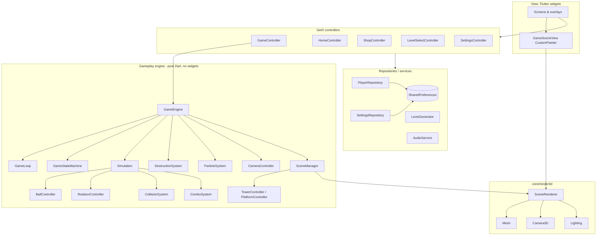
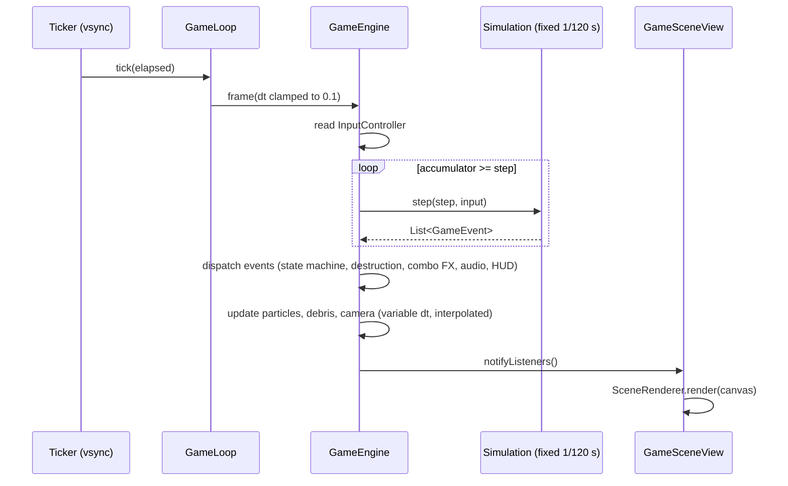
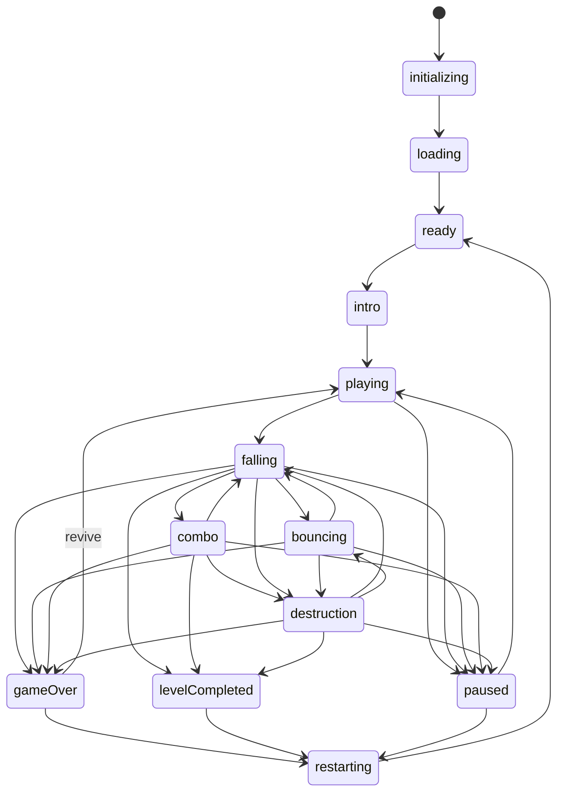
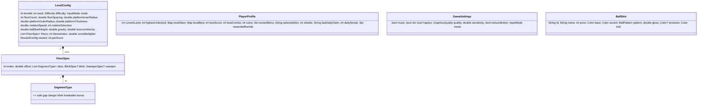
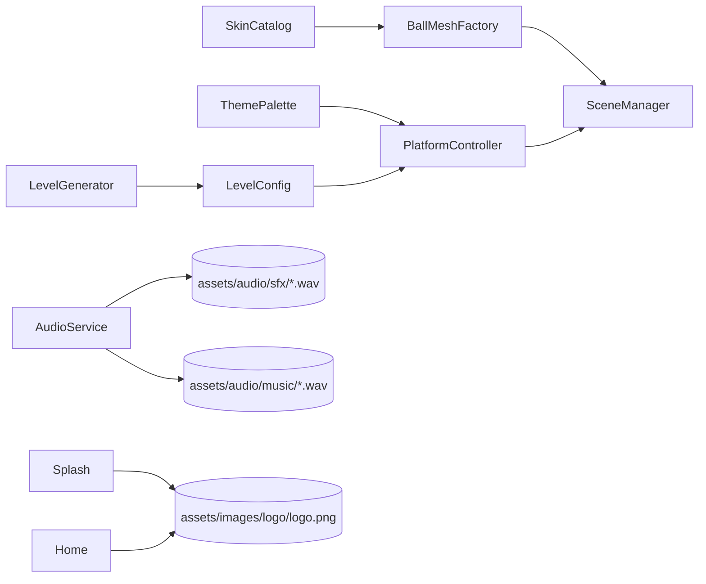

# Ball Game : Fire Ball — Technical Architecture

## 1. Package selection and the rendering decision

| Need | Choice | Why |
|---|---|---|
| App state / DI / routing | `get` 4.7 | Required by brief; reactive `Rx` for HUD, bindings for DI |
| Persistence | `shared_preferences` | Profile is one small JSON document + settings; a database is unnecessary (documented) |
| Audio | `audioplayers` 6.8 (`AudioPool` for SFX, looping player for music) | Mature on Android/iOS, low-latency pools |
| 3D rendering | **In-house real-time 3D renderer on `Canvas.drawVertices`** | see below |
| Physics / collision | Custom deterministic Dart | Brief requirement; logical collision instead of mesh overlap |

### three_js evaluation (rejected for v1, swappable later)

`three_js` 0.3.0 (pub.dev, checked 2026-11-14) renders through ANGLE/`flutter_angle` external textures. Its own
README lists open issues on our two target platforms: *"iOS: Protoplanets doesn't function correctly"*, *"Android:
Morph targets fail on some devices; some RGBELoaders crash the app"*, PMREM artifacts on all platforms, and states
GPU support is "currently under development" with the ANGLE backend moving to a package that "does not exist" yet.
The brief requires physical-device validation before committing; no physical device is available in this environment
(the attached iPhone is not in Developer Mode and no Android device is configured), so its texture interop and
lifecycle handling cannot be validated. Committing the core of a commercial game to that is a production risk.

**Alternative chosen:** a small purpose-built 3D pipeline in Dart:

- Real 3D meshes (vertices, normals, per-vertex colours) for ball, tower, platforms, hazards, debris.
- Model/view/perspective transforms, back-face culling, per-vertex Blinn–Phong + hemisphere lighting, depth fog.
- Painter's-algorithm depth sort (O(n) bucket sort) and **one `drawVertices` call per frame** → GPU-rasterised by Skia/Impeller.
- No platform channels, no external textures → identical on Android and iOS, survives backgrounding, trivially disposable.
- Our scene is ≈2–5k triangles; budget measured in `docs/testing/performance.md`.

The renderer sits behind `SceneRenderer`; the game engine only produces a `RenderScene` (meshes + transforms),
so a GPU backend (three_js / flutter_gpu) can replace it without touching gameplay.

## 2. Layering (MVVM, feature-first)

Rules: the engine never imports Flutter widgets or GetX; the renderer never mutates game state; controllers
translate engine events into `Rx` values and persistence.

## 3. Game loop

Only one `GameLoop` exists per `GameEngine`; it is owned by the game screen state, stopped on pause and
`AppLifecycleState.paused/inactive`, and disposed with the screen — returning to the app never creates a second loop.

## 4. State machine

`paused → playing` resumes the remembered active sub-state. Any other transition is rejected (returns `false`, logged).

## 5. Data model

Levels are **generated**, not stored: `LevelGenerator.generate(level, mode)` is a pure function of
`(level, mode)` using a seeded PRNG (`seed = fnv1a("spiral-plunge/$mode/$level")`), so restarting a failed level
recreates the identical tower. Generated configs are cached.

## 6. Asset dependencies

3D geometry is procedural (no model files to load); see `assets/asset_manifest.json`.

## 7. Performance strategy

- Fixed-capacity typed buffers reused every frame; no per-frame `List` growth in the hot path.
- Only floors in `[current−2, current+visibleAhead]` are meshed; meshes cached per floor and rebuilt only on change.
- Back-face culling before lighting; bucket sort instead of comparison sort.
- Debris and sparks come from fixed pools (no allocation during play).
- Graphics quality scales visible floors, arc subdivision, sphere resolution, particle density and trail length.
- HUD uses `Obx` on narrowly scoped `Rx` values; the 3D view repaints via a `Listenable`, not `setState`.
